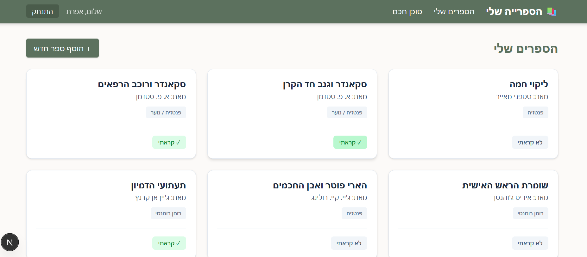
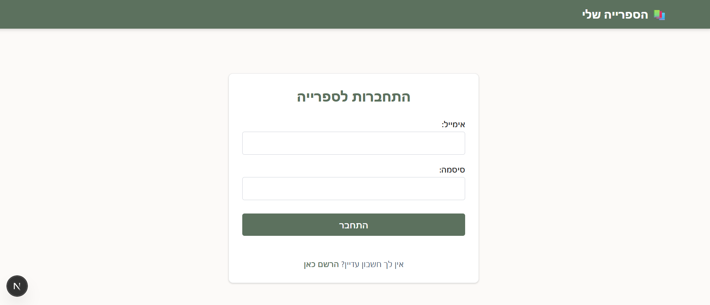
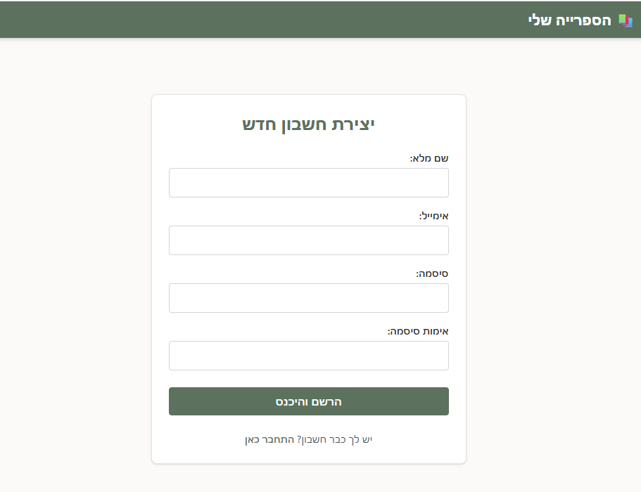
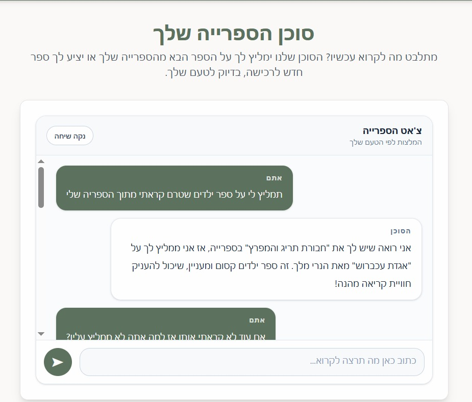

# 📚 הספרייה שלי - אפליקציית ניהול ספרים עם סוכן AI

**מגישות הפרויקט:**

- אפרת כהן אביעד
- חיה יפרח
  **קורס:** Full-Stack, היחידה ללימודי חוץ

---

אפליקציית Full-Stack לניהול ספרייה אישית, המאפשרת למשתמשים לנהל את אוסף הספרים שלהם ולקבל המלצות קריאה מותאמות אישית מסוכן AI חכם.

## 🚀 מה האפליקציה עושה?

- **מערכת משתמשים מלאה:** הרשמה, התחברות והתנתקות מאובטחת (הצפנת סיסמאות עם bcrypt ושמירת סשן בעוגיית HTTP-only).
- **ניהול ספרייה אישי:** כל משתמש רואה ומנהל רק את הספרים השייכים לו (תמיכה בפעולות CRUD, כולל מעקב אחר סטטוס "קראתי / לא קראתי").
- **פרטי ספר מורחבים:** שמירת מידע מדויק על כל ספר - ז'אנר, סדרה, מיקום מדף, ברקוד, ושיוך למשתמשים שונים בבית.
- **סוכן AI חכם:** צ'אט עם עוזר ספרייה אישי שמבוסס על OpenAI. הסוכן זוכר את הקשר השיחה, מבין את טעמו של המשתמש, וממליץ על ספרים לקריאה לפי דרישה (כולל שמירת היסטוריית שיחות מלאה במסד הנתונים).

## 💻 טכנולוגיות מרכזיות

- Next.js (App Router)
- MongoDB & Mongoose
- @openai/agents
- Tailwind CSS

## 📸 צילומי מסך

**דף הספרייה (רשימת הספרים):**

**דף ההתחברות:**

**דף הרשמה:**

**שיחה עם סוכן ה-AI:**

## ⚙️ משתני סביבה נדרשים

כדי להריץ את הפרויקט, יש ליצור קובץ .env.local בתיקיית השורש ולהזין את הערכים הבאים (ניתן לראות את שמות המשתנים בקובץ .env.example):

- MONGO_URI
- OPEN_AI_KEY
- AUTH_SECRET

## 🛠️ איך מריצים את הפרויקט?

1. פתחו את הטרמינל ונווטו לתיקיית הפרויקט.
2. התקינו את התלויות על ידי הפקודה: npm install
3. צרו קובץ .env.local והזינו לתוכו את משתני הסביבה הנדרשים.
4. הפעילו את שרת הפיתוח על ידי הפקודה: npm run dev
5. פתחו את הדפדפן בכתובת: http://localhost:3000
